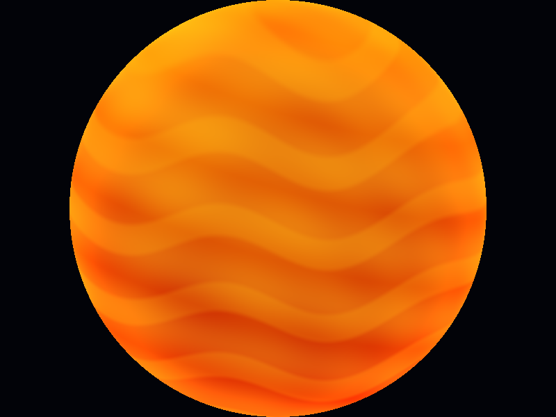
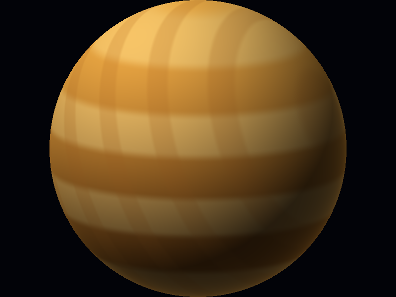
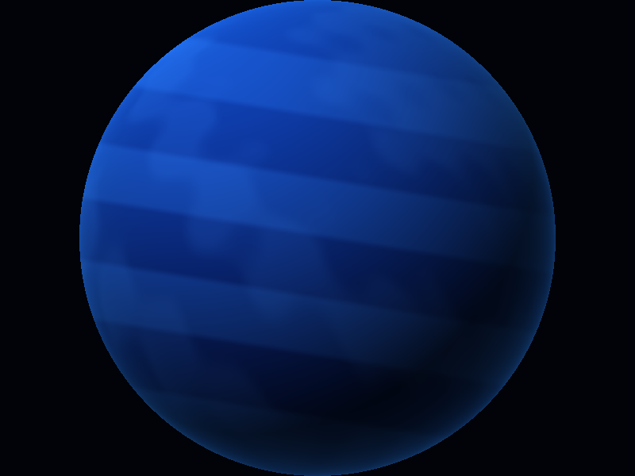
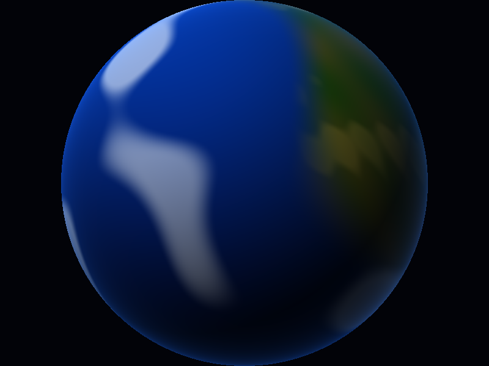
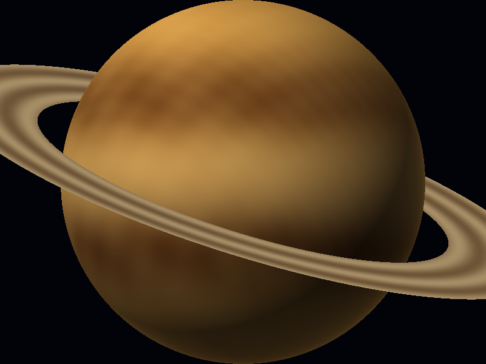
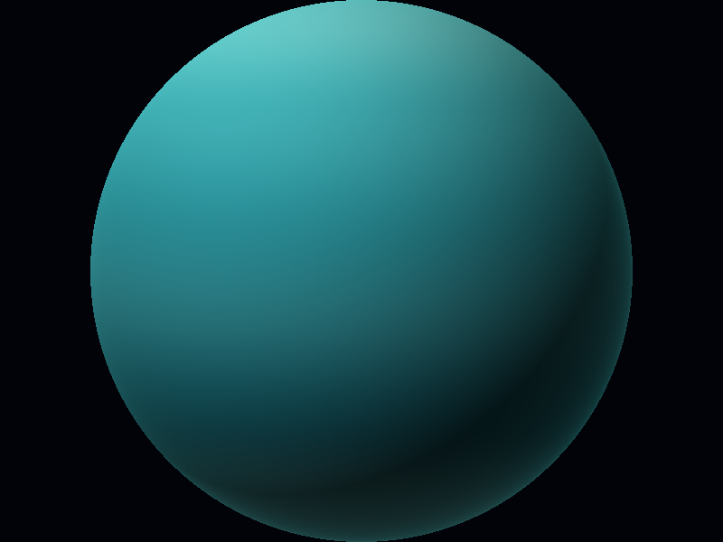

# Solar System Shaders

Renderer de software escrito completamente en Rust. Cada cuerpo celeste se dibuja como una esfera calculada píxel por píxel y su apariencia se genera con shaders procedurales, sin texturas ni materiales.

## Ejecutar

```powershell
cargo run
```

También se pueden generar todas las capturas con:

```powershell
cargo run -- --all-screenshots
```

## Controles

- `1` Sol
- `2` Venus
- `3` Neptuno
- `4` Tierra
- `5` Saturno
- `6` Urano
- `Left/Right Arrow` cambiar de planeta
- `S` guardar screenshot
- `Esc` cerrar

## Shaders

Los shaders usan gradientes, bandas, ondas `sin`, ruido procedural, `smoothstep`, iluminación difusa y efectos de borde. La Tierra utiliza capas para océanos, continentes, terreno, nubes y atmósfera. Saturno tiene un modelo procedural de anillos separado y prueba de profundidad.

La iluminación de los planetas usa una luz direccional fija con sombreado difuso. El Sol es emisivo y se muestra con capas de temperatura, convección, filamentos de plasma y brillo de borde.

## Resultados

| Sol | Venus | Neptuno |
|---|---|---|
|  |  |  |

| Tierra | Saturno | Urano |
|---|---|---|
|  |  |  |
